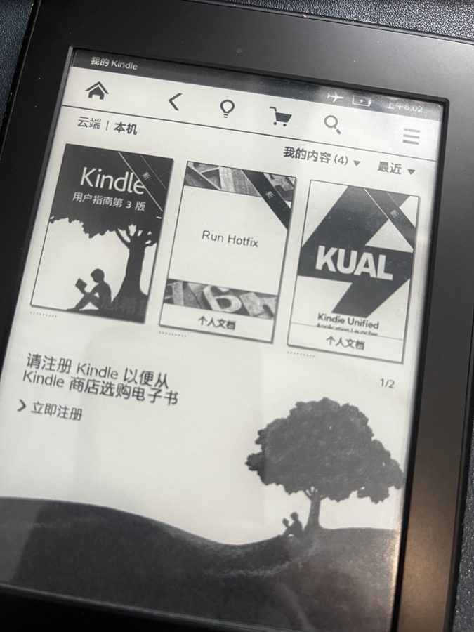
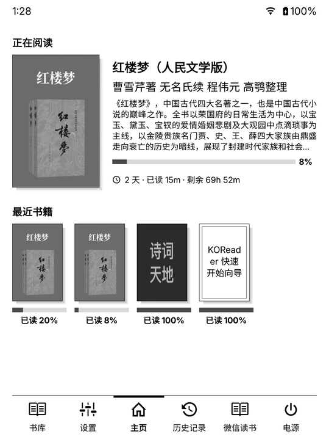
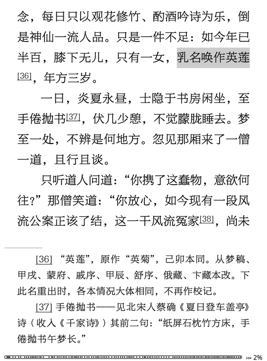
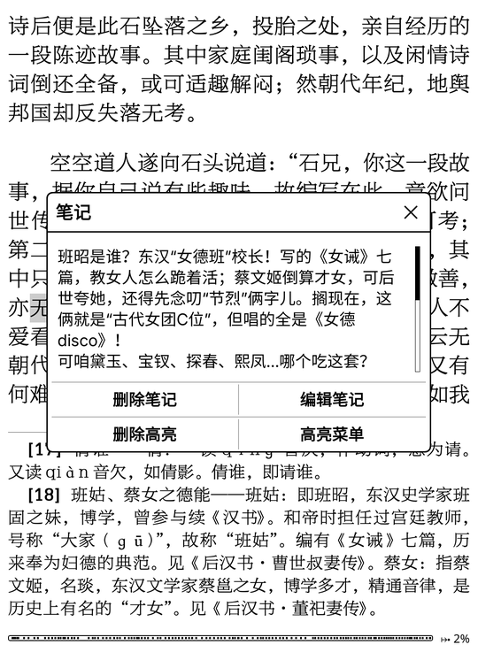

# kindle-jailbreak

两台 Kindle 的越狱操作记录。每一步都在真机上做过，失败的尝试和原因也写在里面。

越狱之后装 KOReader，还可以装微信读书、带封面的首页，并让电脑远程看屏幕。

## 越狱前后

| 越狱前 | 越狱后：首页 |
| --- | --- |
|  |  |
| Kindle 原系统书架（Paperwhite 一代，手机拍摄） | KOReader 加 SimpleUI，底栏有微信读书入口 |

| 读书：划线和脚注 | 点划线看别人的想法 | 锁屏 |
| --- | --- | --- |
|  |  |  |
| 方正博雅方刊宋，脚注排在页底，灰底是划线 | 微信读书里别人写的想法，在 Kindle 上直接看 | 自己做的古画锁屏，每次随机一张 |

后四张是 Oasis 一代的屏幕截图，Paperwhite 一代装好后效果相同，屏幕小一些。字体是商业字体，不在仓库里，要自己准备。

## 交给 AI 助手来做

把下面这段话发给你的 Claude Code、Codex 或其他能运行命令的 AI 助手：

```
帮我按这个仓库给 Kindle 越狱：https://github.com/finalbsd/kindle-jailbreak
先把仓库下载到本地，读 AGENTS.md，再问我型号和固件版本。
```

AI 助手能做的：下载固件和越狱包、核对哈希、拷进 Kindle、装插件、开了 SSH 后远程看日志和截屏。

AI 助手做不了、要你自己动手的：在 Kindle 屏幕上点按钮、长按电源键、插拔数据线、扫码登录微信读书。每到这一步，它会告诉你点哪里、会看到什么。

下载地址都是公开的，不需要账号。Paperwhite 一代有现成的下载脚本 `devices/paperwhite1/fetch-files.sh`，会自动核对哈希。文件放在别人的服务器上，哪天地址失效，脚本会报错停下，不会装错文件。

## 先找你的型号

| 设备 | 固件 | 方法 | 要不要亚马逊账号 | 指南 |
| --- | --- | --- | --- | --- |
| Kindle Oasis 第一代（2016） | 5.16.2.1.1 | WinterBreak2 | 不要 | [devices/oasis1](devices/oasis1/README.md) |
| Kindle Paperwhite 第一代（2012） | 5.6.1.1 | 降级到 5.4.4.2 → K5 越狱 → 升回 | 不要，也登不上 | [devices/paperwhite1](devices/paperwhite1/README.md) |

不在表里的型号，先用官方向导查：https://kindlemodding.org/jailbreak-wizard.html 。仓库里的方法不一定适用，别照搬。

**型号怎么看**：Kindle 上点“设置 → 设备信息”，看序列号前几位和固件版本。也可以连电脑后读磁盘根目录里 `system/version.txt`。

## 越狱之后

- [KOReader 装好之后：微信读书、首页、SSH](docs/koreader-and-plugins.md)
- [日常维护手册](docs/maintenance.md)：备份、防升级、清空间、远程截屏、卡死和触摸失灵怎么办。配一个只读的体检脚本 `tools/kindle-health.sh`

## 给 AI 助手

如果你是被用户叫来帮忙越狱的 AI 助手，先读 [AGENTS.md](AGENTS.md)。里面写了哪些步骤你能做、哪些必须用户自己做、哪些要先问。Claude Code 会通过 `CLAUDE.md` 自动读到它。

## 原来的书和字体会不会丢

不会丢。越狱只往 Kindle 里加文件，不删原来的书。我们这两台越狱前后，原来的书、字体、阅读进度都还在。Paperwhite 一代降级再升回固件，书也都在。

还是建议动手前备份一份到电脑，万一操作失误要恢复出厂设置，书就没了：

1. 用数据线连电脑，Kindle 会显示成一个磁盘。
2. 把整个磁盘复制到电脑上的一个文件夹。至少复制 `documents/`（书和阅读进度）和 `fonts/`（自己加的字体，没有就跳过）。
3. 复制完对一下文件数，再推出磁盘。

几点说明：

- 从亚马逊买的书带版权保护（DRM）。越狱后它们还在原系统的书架上，照样能读，但 KOReader 打不开。
- 2012 年及更早的型号已经不能登录亚马逊账号，书丢了没法重新下载，所以这类机器更要先备份，也千万别恢复出厂设置。
- Oasis 的 WinterBreak2 要先用占位文件把存储塞满。只加占位文件，不要为了腾空间删书。

## 重要提醒

- 越狱有风险：会失去保修，操作失误可能让设备无法开机。降级和升级用的是亚马逊官方固件，风险低但不是零。
- 这个仓库不提供固件。固件、越狱包和插件的下载地址和哈希都写在各设备指南里，由你自己下载并核对。
- 仓库里的内容是操作记录，不构成保证。设备坏了没人负责，包括作者。
- 与亚马逊没有任何关系。

## 记录里的几条经验

- 官方支持表写“支持”，不等于每台都行。看看你的型号在 GitHub issue 里有没有人遇到过同样的问题。
- 亚马逊在 2026-05-20 停止了 2012 年及更早型号的支持，这些机器不能再登录账号。凡是要求“已注册”的方法对它们无效。
- 越狱文件拷进 Kindle 后，**不要急着推出磁盘**，保持 USB 驱动器模式，按教程的步骤触发。
- 墨水屏断电后会保留旧画面。屏幕上还写着“USB 驱动器模式”，不等于它没在重启。
- 拍照要拍序列号和 MAC 的话，发出去之前先涂黑。

## 目录

```
devices/oasis1/        Oasis 一代：WinterBreak2 + KPM 装 KOReader
devices/paperwhite1/   Paperwhite 一代：老办法，含下载脚本、哈希、照片
docs/                  越狱之后的 KOReader 插件、日常维护手册
tools/                 体检脚本（通过 SSH 只读查看状态）
AGENTS.md              给 AI 助手的操作规则
CHANGELOG.md           更新记录
```

## 许可

文档和脚本用 MIT 许可（见 [LICENSE](LICENSE)）。仓库里提到的第三方软件（KOReader、KUAL、热修复、越狱包、各插件）各自有许可，我们不重新分发它们。
