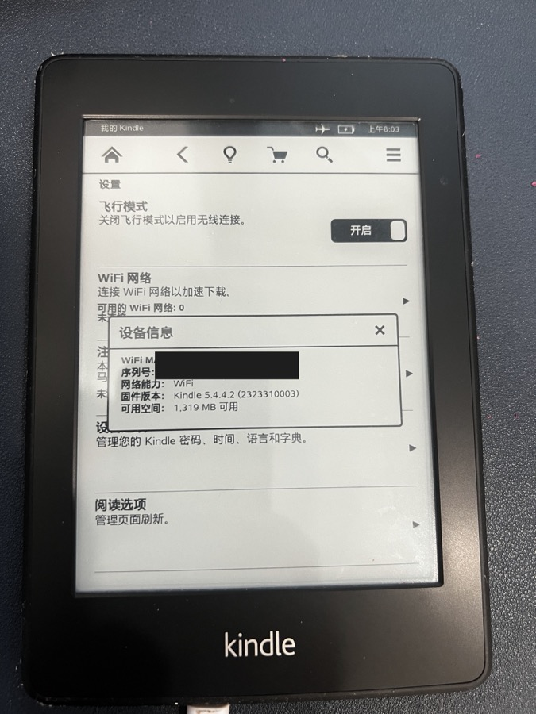
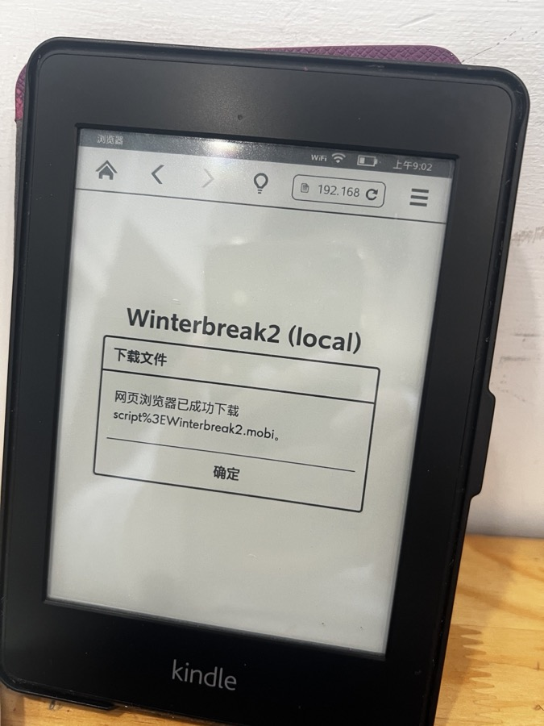
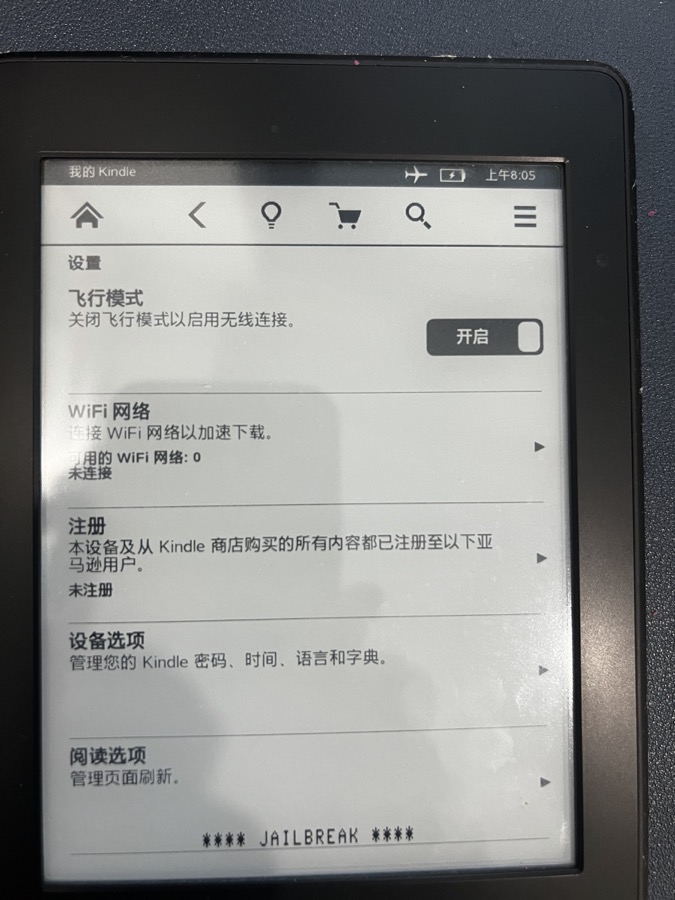
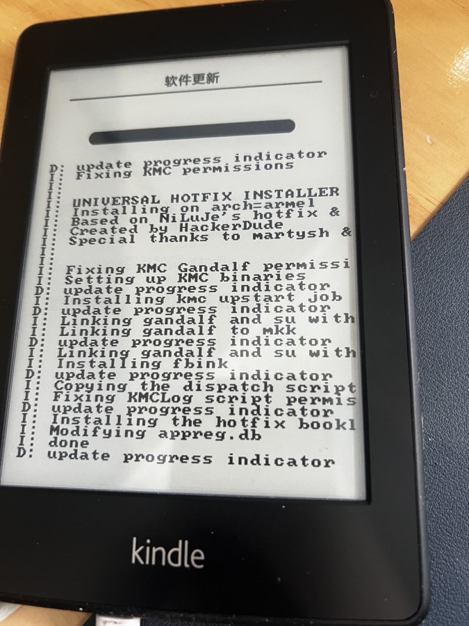
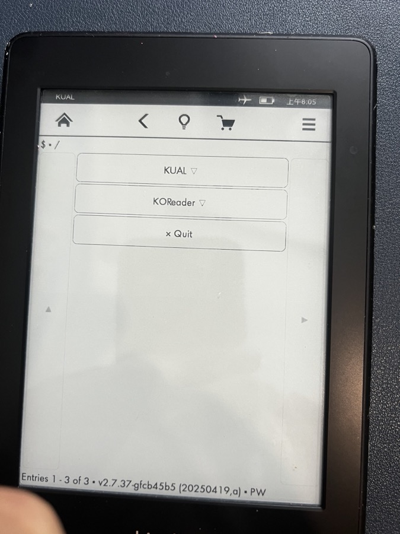

# Kindle Paperwhite 一代（2012）越狱

适用：Kindle Paperwhite 第一代，固件 5.6.1.1，**没登录亚马逊账号，也登不上**。

实测结果（2026-10-27）：越狱成功，KOReader 能用，全程没登账号。

## 先看这个

亚马逊从 2026-05-20 起停止支持 2012 年及更早的 Kindle，包括这一台。它们不能再注册账号，商店也不能用。

所以两个常见方法在这台上都走不通：

- WinterBreak 要求 Kindle 已注册账号。登录会报错，密码对也一样。
- WinterBreak2 不用账号，官方支持表也写支持 5.6.1.1，但实测下载后没有任何反应（原因见文末排错表）。

能走通的是老办法：降级到 5.4.4.2，用老式的 K5 越狱，再升回 5.6.1.1。别人也在同一台机型上走通了（见文末来源）。

## 适用范围

| 项目 | 内容 |
| --- | --- |
| 型号 | Kindle Paperwhite 1（2012），Wi-Fi 版 |
| 序列号 | 以 B024 开头（实测）。3G 版序列号不同，没测 |
| 固件 | 5.6.1.1（这台机型的最后一版固件） |
| 电脑 | macOS（命令按 macOS 写，Linux 基本相同） |
| 需要 | 一根能传数据的 Micro-USB 线；电量 50% 以上 |
| 全程用时 | 约 1 小时（USB 写入慢，固件各 190–220 MB） |

确认型号：Kindle 上点“设置 → 菜单 → 设备信息”，看序列号前四位和固件版本。

## 风险

- 降级和升级用的都是亚马逊官方固件，砖掉的风险低，但不是零。
- **不要恢复出厂设置。** 恢复后设备可能再也注册不上，也就进不了系统。
- 越狱会失去保修（这台早已过保）。
- 下面所有步骤里，需要在 Kindle 上点屏幕的，只能你自己点。

## 要用的文件

文件不放在仓库里（固件版权归亚马逊）。运行脚本下载并核对哈希：

```
sh devices/paperwhite1/fetch-files.sh
```

文件会下载到 `devices/paperwhite1/files/`。哈希对不上就别往 Kindle 里拷。

| 文件 | 用途 | 来源 |
| --- | --- | --- |
| update_kindle_5.4.4.2.bin | 降级固件（191.6 MB） | 亚马逊官方 S3 |
| kindle-5.4-jailbreak.zip | K5 越狱包（NiLuJe） | KindleModding 仓库（Git LFS） |
| Update_hotfix_universal.bin | 热修复，让越狱在升级后保留 | KindleModding/Hotfix |
| KUAL-KDK-2.0.azw2 | 启动器，放进 documents/ | NiLuJe 快照帖里的 KUAL v2.7.37 |
| koreader-kindle-v2026.07.1.zip | KOReader（`kindle` 版） | KOReader 官方发布页 |
| update_kindle_5.6.1.1.bin | 升回的固件（217.5 MB） | 亚马逊官方 S3 |

KOReader 选 `koreader-kindle`，不要选 `legacy`、`pw2`、`hf`。KOReader 官方 wiki 把“银黑 Kindle 4、Kindle Touch、初代 Paperwhite”列在 `kindle` 这一版。

## 步骤

### 1. 准备

1. Kindle 打开飞行模式（设置里）。整个过程保持开着。
2. 想留的书先拷到电脑上。
3. 用数据线连到 Mac，Kindle 会显示“USB 驱动器模式”，访达里出现名为 Kindle 的磁盘。

### 2. 降级到 5.4.4.2

1. 把 `update_kindle_5.4.4.2.bin` 拷到 Kindle 磁盘的根目录。
2. **不要点推出磁盘**，数据线也不要拔，Kindle 保持 USB 驱动器模式。
3. 等 1–2 分钟。
4. 长按 Kindle 的电源键，**一直按住，别松手**。屏幕上弹出“重启/关闭屏幕”的提示也别点，继续按。
5. 按到屏幕或指示灯熄灭，约 40 秒，再松手。
6. 它会重启，屏幕显示“正在更新 Kindle 软件”和进度条，几分钟。别碰它。
7. 开机后打开“设置 → 菜单 → 设备信息”，固件应为 **5.4.4.2**。

不要用“设置 → 菜单 → 更新您的 Kindle”降级。这个菜单只接受更新的固件，会提示“无效的更新文件”，这是正常的拒绝，不是文件坏了。

### 3. 装 K5 越狱

1. Kindle 连回 Mac。
2. 把 `kindle-5.4-jailbreak.zip` 解压到 Kindle 根目录，一共 7 个文件，其中一个文件名里带命令：

   ```
   unzip -o kindle-5.4-jailbreak.zip -d /Volumes/Kindle
   ```

3. 推出磁盘，拔线。
4. 在 Kindle 上：设置 → 菜单 → **更新您的 Kindle**。
5. 几秒后屏幕底部出现 `**** JAILBREAK ****`，越狱成功。
6. 设置 → 菜单 → 重新启动，手动重启一次。

重启后根目录里的越狱文件会被系统取走，多出 `mkk/` 等文件夹，这是正常的。

### 4. 装热修复

1. 连回 Mac，把 `Update_hotfix_universal.bin` 拷到根目录。根目录不能有别的 `.bin` 文件。
2. 推出，拔线。设置 → 菜单 → 更新您的 Kindle → 确认“更新”。
3. 屏幕会滚一屏日志：`UNIVERSAL HOTFIX INSTALLER`，最后 `done`。
4. 装完后书架里多出一个 **Run Hotfix**。先不用点。

### 5. 放入 KUAL 和 KOReader

1. 连回 Mac。
2. 把 `KUAL-KDK-2.0.azw2` 拷进 `documents/`。
3. 把 `koreader-kindle-v2026.07.1.zip` 解压到根目录，会得到 `koreader/` 和 `extensions/` 两个文件夹：

   ```
   unzip -o koreader-kindle-v2026.07.1.zip -d /Volumes/Kindle
   ```

4. 删掉 macOS 生成的 `._` 文件：

   ```
   find /Volumes/Kindle -name '._*' -delete
   ```

**不要用 PEKI 版 KUAL**（`KUAL.sh` + `KUAL.jar`）。KindleModding 的教程对 K5 一律指向 PEKI，但 PEKI 只支持固件 5.12.2.2 及以上。在这台上点了没有任何反应。

### 6. 升回 5.6.1.1

1. 把 `update_kindle_5.6.1.1.bin` 拷到根目录，推出，拔线。
2. 设置 → 菜单 → 更新您的 Kindle → 更新。这次是真正的系统升级，要几分钟，期间别碰它。
3. 重启后看“设备信息”，应为 5.6.1.1。
4. 书架里点一次 **Run Hotfix**。官方说明里写着，每次系统更新后都要点一次。它会一直留在书架里，是正常的。

热修复在步骤 4 已经装好，所以升级后越狱保留。

### 7. 启动 KOReader

1. 书架里点 **Kindle Unified Application Launcher**（就是 KUAL，书架上显示全名）。
2. 里面有 KUAL 和 KOReader 两项。点 **KOReader**。
3. 点 **Start KOReader (no framework)**。

`no framework` 会停掉 Kindle 原系统再启动 KOReader，退出时自动恢复。这台只有 256 MB 内存，实测这样启动后 KOReader 一共占约 89 MB，还剩约 160 MB。平时就用这一项。

### 8. 之后

- 装微信读书、首页等插件，见 [../../docs/koreader-and-plugins.md](../../docs/koreader-and-plugins.md)。
- 看别人的划线、换锁屏图、加字体，也在那份文档里。看别人的划线时一次只匹配两三章，这台内存小，整本一起匹配会被系统杀掉。
- KOReader 里连 Wi-Fi，不需要亚马逊账号。联网时尽量只在 `no framework` 模式下，因为那时 Kindle 原系统没有运行。

## 排错：我们踩过的坑

| 现象 | 原因 | 怎么办 |
| --- | --- | --- |
| WinterBreak2 点了 Jailbreak，只弹出“网页浏览器已成功下载 script%3EWinterbreak2.mobi”，没有任何反应，也没有日志 | 老浏览器把文件名里的 `>` 转成 `%3E`，藏在文件名里的脚本被“消毒”，越狱的第一步没有触发。换成本地 http 页面也一样，所以和 https 无关 | 改走本文的老办法。GitHub 上有人报告本地搭页面能成，我们这台不行，没查清 |
| WinterBreak 要登录账号，一直报错 | 亚马逊已停止支持这台，不能注册 | 同上 |
| 降级时菜单提示“无效的更新文件” | 菜单只收更新的固件 | 用长按电源键强制重启，见步骤 2 |
| 拷进去的 `.bin` 文件消失了，固件没变 | Kindle 看了一眼文件就删了，没安装。我们试了三次才成功 | 按步骤 2 的做法：不推出磁盘，保持 USB 模式，按满约 40 秒 |
| 屏幕上点“重启”没用 | 那是普通重启，不会装固件 | 要长按电源键强制重启 |
| 按电源键到 20 秒还没反应 | 不够久 | 按满 40 秒，中间屏幕还显示“USB 驱动器模式”也不要松手。墨水屏断电后会保留旧画面，不是死机 |
| 点 KUAL，什么都没出现 | 用了 PEKI 版 KUAL，不支持老固件 | 换成 `KUAL-KDK-2.0.azw2`，放进 `documents/` |
| 点 KUAL（KDK 2.0），弹“无法启动选定的应用程序，请重试” | 在 5.4.4.2 上出现，升回 5.6.1.1 并点过 Run Hotfix 后正常。确切原因没查清 | 按步骤 6 升回 5.6.1.1 |
| 找不到 KUAL | 书架上它的名字是 Kindle Unified Application Launcher | 找这个全名 |
| 微信读书插件匹配划线时，KOReader 突然退出、像重启了一样 | 整本书一起匹配，内存不够，被系统杀掉（内核日志里有 OOM） | 用“选择章节匹配”，一次两三章。已匹配的章节会保存 |
| `kindle-5.4-jailbreak.zip` 解压失败，文件只有 130 字节 | 下到的是 Git LFS 占位文件 | 用 `media.githubusercontent.com` 的地址，脚本里已处理，并核对哈希 |

## 记录里没有验证的地方

- 只在一台设备上试过（序列号 B024 开头，Wi-Fi 版）。
- 降级那一步，哪个因素起了决定作用没分开验证：不推出磁盘、用 5.4.4.2 而不是 5.4.4、按满 40 秒，这三样我们同时改了。
- 拍照里的 Kindle 时钟没联网校时，照片上的时间不准。

## 照片

| | |
| --- | --- |
|  |  |
| 降级后的设备信息：5.4.4.2（序列号、MAC 已涂黑） | WinterBreak2 提示下载成功，之后没有反应 |
|  |  |
| 设置页底部出现 `**** JAILBREAK ****`，注册一栏是“未注册” | 热修复安装日志 |
|  |  |
| 书架：Run Hotfix 和 KUAL | KUAL 菜单：KUAL、KOReader、Quit |

## 来源

- 亚马逊停止支持：[WAVE 报道](https://www.wave3.com/2026/04/09/kindle-e-readers-released-2012-or-earlier-will-no-longer-be-supported-by-amazon)，[NBC 报道](https://www.nbcnewyork.com/news/national-international/kindle-models-discontinued-support-controversy/6487993/)
- PW1 上 WinterBreak2 的问题和老办法：[KindleModding/Winterbreak2 issue #1](https://github.com/KindleModding/Winterbreak2/issues/1)
- 老办法的完整教程：[oakreef.ie 的博客](https://oakreef.ie/bog/kindle-jailbreaking)
- 降级的做法（强制重启，不要用菜单）：[MobileRead 帖子](https://www.mobileread.com/forums/showthread.php?p=4602604)
- 越狱包、KUAL、热修复：[NiLuJe 快照帖](https://www.mobileread.com/forums/showthread.php?t=225030)，[KindleModding](https://kindlemodding.org/)
- KOReader 选哪一版：[KOReader wiki](https://github.com/koreader/koreader/wiki/Installation-on-Kindle-devices)
